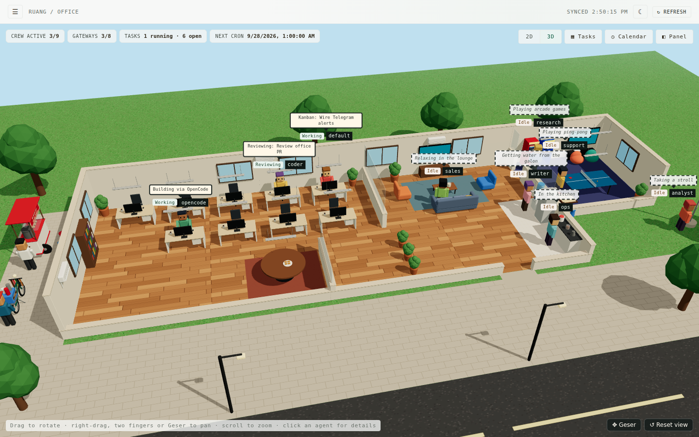
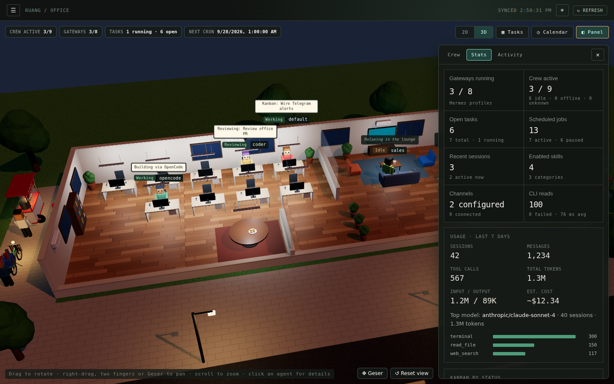

# Space · 3D Virtual Office

*Space* is a fork of *Ruang*, Indonesian for "room" or "space". It is a 3D virtual office and read-only mission control for your local [OpenCode](https://opencode.ai) install. See who is working and what they are doing, plus folders and memory, all in one place. Everything is read from OpenCode's own folder and its `--version`, and nothing is ever changed.

> This is a derivative of [Ruang](https://github.com/yugienugraha/ruang) by **yugienugraha** (MIT), adapted to be OpenCode-only (the Hermes integration has been removed). Original credit belongs to yugienugraha.





## Install

Works on macOS, Linux and Windows through WSL2. You need `opencode` on your `PATH`. The installer downloads its own Node.js if you do not have Node.js 20 or newer.

```bash
curl -fsSL https://raw.githubusercontent.com/nvafandi/space/main/install.sh | bash
```

Then start it and open http://127.0.0.1:3001:

```bash
space                        # or: space --port 3005
```

- **Run it in the background, and at boot (Linux):** add `--service` to install a systemd user service:
  `curl -fsSL https://raw.githubusercontent.com/nvafandi/space/main/install.sh | bash -s -- --service`
  To keep it running after you log out, also run `loginctl enable-linger $USER`.
- **Update:** run the install command again.
- **Remove:** add `--uninstall` (`... | bash -s -- --uninstall`).
- **Other options:** `--version v0.2.0` installs a specific release; `--from-source` builds the latest `main` (needs `git`). See `install.sh --help`.
- **On a server:** Space listens on `127.0.0.1` only. From your laptop, run `ssh -L 3001:127.0.0.1:3001 user@server`, then open http://127.0.0.1:3001.

Everything goes into `~/.local/share/space`, plus the `space` command in `~/.local/bin`. No sudo is used and nothing is installed system-wide. Prefer to read the script before running it? `curl -fsSL https://raw.githubusercontent.com/nvafandi/space/main/install.sh -o install.sh`, read it, then `bash install.sh`.

**With your own Node.js 20+:** download `space.tgz` from the [latest release](https://github.com/nvafandi/space/releases/latest) and run `npm install -g ./space.tgz`. Once the package is on npm this becomes `npm install -g space` (or `npx space`).

## Development

Requires Node.js 20+ and `opencode` on the `PATH` of the shell that starts the server.

```bash
git clone https://github.com/nvafandi/space.git
cd space
npm install
npm run dev        # API on 127.0.0.1:3001 + Vite UI (open the URL Vite prints, usually http://localhost:5173)
```

Production from a checkout (single process, serves the built UI and the API):

```bash
npm run build      # builds the UI into dist/ and the server into build/server/
npm start          # open http://127.0.0.1:3001
```

Checks: `npm run lint`, `npm test`, `npm run build`.

**After pulling new code** run `npm install && npm run build` and restart `npm start` (a running `npm start` keeps serving the old API; `npm run dev` restarts the API by itself). The UI checks `/api/health` and shows a *Restart needed* banner when the server is older than the page. Set `SPACE_PORT` (or pass `--port`) to change the port. The server binds to `127.0.0.1` only. The older `MISSION_CONTROL_*` settings still work.

**Releasing:** bump the version and push the tag, for example `npm version 0.2.1 && git push origin main --follow-tags`. The *Release* workflow then lints, tests, builds and attaches `space.tgz` to a GitHub release, which the installer picks up. To also publish to npm, add an `NPM_TOKEN` repository secret.

## Pages

Space has one agent source: OpenCode, when it is installed on this machine. There are no profiles.

- **Agents**: the agents discovered on this machine, and what each is doing in the office. Agents are discovered, not configured: OpenCode appears when the server can read its version. Each agent gets its own character colours derived from its name.
- **Office** (home page): the office fills the screen below the header. A HUD across the top shows crew active and (when any) failed CLI reads; chips link to their page. The **Panel** button opens one side panel with three tabs: **Crew** (crew snapshot and a clickable list of stations), **Stats** (statistics across every source, runtime and what is up next; tiles link to their pages) and **Activity** (unattributed session metadata and messaging channels). The **Tasks**, **Calendar** and **Tokens** buttons open the Task Board, a month calendar of cron runs or token usage over the office, without leaving it (Esc or ✕ closes them; *Open full page* goes to the page). `#/dashboard` opens the Office.

  The view switches between **3D** (the default) and **2D**, remembered per browser; browsers without WebGL stay on 2D. The 3D view (three.js via React Three Fiber, loaded only when used) is an office of several rooms with an Indonesian touch:
  - the workspace: hot desking, with one unlabeled desk per agent in two rows (the building widens for a larger crew), and a glass-walled meeting room by the aisle: a long table with a chair for every agent (it grows with the crew), a TV on a stand showing a slide, and a whiteboard
  - a lounge behind a glass partition, where the sofa faces a TV on the back wall
  - a game room through a door from the lounge: ping-pong, two arcade machines, a console corner with beanbags, and a karambol (carrom) board
  - a pantry with a galon (water-jug) dispenser
  - split ACs on the walls (outdoor units behind the building) and suspended cool-white LED office lights
  - the Merah Putih flag at the corner of the grounds
  - in the alley beside the building, out of the main view: a bakso (meatball soup) cart and a kopi keliling (coffee bike), each with its vendor

  It follows the theme: day in light mode, evening in dark mode, when the office lights, street lamps and cart lamps light up. Only procedural textures are used, with no image or model files. Drag to rotate, scroll to zoom, and pan with right-drag, two fingers, the arrow keys, or the **Geser** button (which makes a plain drag pan). Panning stays within the grounds, and **Reset view** returns to the starting view.

  The building has two floors; the buttons at the top left of the 3D view (or Page Up / Page Down) switch between them, each showing how many agents are on it. **Lantai 1** is the office. **Lantai 2**, up the stairs by the entrance, has a dorm bedroom with one bed per agent, a lesehan corner, a bathroom, and a ruko-style balcony with rattan chairs, a hammock, a clothes line and string lights; the lower floor turns into a closed building below it, and agents outside on the ground stay in view. Idle agents also go upstairs to sleep, nap in the hammock or sit on the balcony; the **💤 Tidur** button sends every idle agent to bed (remembered per browser, like the floor). Sleeping is decorative only, like the rest of the idle wandering.
  Each agent has its own desk. Idle agents do not just sit: every 32 seconds each one moves on to another stop, such as relaxing in the lounge, ping-pong, arcade games or the console in the game room, getting water from the galon, the kitchen, bakso on the cart's stools, coffee at the bike, or a stroll to the flag or the bookshelf. A dashed bubble says where they are. This wandering is decorative only (the same clock-based route for everyone). Click an agent for its detail dialog, with three tabs: **Overview** (state, task, provenance, freshness), **Folder** (that agent's own folder, read-only, as on the Folders page) and **Memory** (its SOUL.md, MEMORY.md, USER.md and context files).
- **Task Board**: the page is still in the menu, but it has no data behind it. It used to be a Kanban board; the CLI it read is gone, so the board shows an empty state.
- **Calendar**: present but empty. It used to graph cron runs; the CLI it read is gone.
- **Activity**: the 20 most recent sessions with search. There is currently no source for session data, so the page shows an empty state.
- **Memory**: per agent, what it carries into every session. For OpenCode this is its global `AGENTS.md`/`CLAUDE.md`. Entries are searchable. Everything is read through the Folders safety layer, so it is read-only, confined to the agent's folder and secret-redacted. `#/knowledge` opens this page.
- **Folders**: OpenCode's own folder, read-only. See *Folders* below.
- **Logs**: present but there is nothing to tail. Space no longer executes any agent CLI, and it never read raw process output, so the page shows an empty state. The *Command audit* tab still audits the commands the server runs (see *Data and safety*).
- **Settings**: the optional access code and profile lock. See *Access code* and *Profile lock* below.

**Token usage** (the **Usage** page in the menu, the **◔ Tokens** button in the Office, and the Panel's Stats tab) is present but shows *Not Available*. It used to add up per-agent token insights; the CLI that reported them is gone.

Navigation is a drawer, closed by default like a game menu: open it with the ☰ button or the **M** key, and close it with Esc, a click outside, or by choosing a page. A dot on ☰ flags failed reads. The header has one light/dark theme toggle (remembered per browser) and Refresh. All pages poll automatically, keep the last good data (marked stale) if a refresh fails, and have a manual refresh. "Refresh all" bypasses the 10-second server cache for anything older than 2 seconds. Pages are addressable by URL hash (for example `#/folders`).

## Access code

Off by default. Turn it on in **Settings → Access code** to ask for a code every time Space is opened in a browser. It works like an API key rather than a username and password:

1. Choose **Generate** (a random code such as `space-7KQ4-M2XD-9PWT-H6RA`) or **Custom** (at least 12 characters, typed twice).
2. **Download .txt** or **Copy** it. The code is only shown while you set it, and Space has no password reset, so the downloaded file is your backup.
3. Tick *I have saved this code*, optionally *Remember this device for 7 days*, and turn it on.

Every browser then shows an unlock screen first. Without *Remember*, a session ends when the browser closes (and after 12 hours at most). **Change code** and **Turn off** need the current code; changing or removing it signs out every browser. **Lock this browser** ends the current session.

Lost the code? On the machine that runs Space:

```bash
space access-code off      # remove it, then set a new one in Settings
space access-code new      # or print a new random code
space access-code status
```

How it is protected:
- Only a scrypt hash of the code is stored, with a random secret that signs sessions, in `~/.config/space/access.json` (mode `0600`; `SPACE_CONFIG_DIR` or `XDG_CONFIG_HOME` move it). The code itself is never stored, logged or kept in the browser.
- The server enforces it: while locked, every `/api` route except `/api/health` and the unlock route answers `401`, so no OpenCode data reaches the browser. The UI shell itself is static and carries no data.
- Sessions use an `HttpOnly`, `SameSite=Strict` cookie. Changes need a same-page request header, so other sites cannot make them.
- After 5 wrong codes, each further try from the same address waits longer (1 s, doubling, up to 5 minutes).
- A damaged `access.json` keeps Space locked rather than open; `space access-code off` clears it.
- This is Space's only write, and it touches Space's own config, never OpenCode.

Space listens on `127.0.0.1`, so the code matters when you reach it from other devices, for example through an SSH tunnel, Tailscale or a reverse proxy. Over plain HTTP the code crosses the network unencrypted; use an HTTPS tunnel or Tailscale for that.

## Profile lock

Off by default. In **Settings → Profile lock**, pick the agents to lock and set one 6-digit PIN, like app lock on a phone. A locked agent still appears in the office (with 🔒 by its name), but its private data stays hidden until the PIN opens that agent in this browser for 15 minutes:

| Data | While locked |
|---|---|
| Folder and file contents, memory (AGENTS.md, CLAUDE.md and other context files) | refused (HTTP 423); the Folder and Memory tabs ask for the PIN |

Unlocking one agent does not unlock the others, and **🔒 Lock again** closes it early. Changing the locked agents, the PIN or turning the lock off needs the current PIN; a new PIN locks every agent again. The server enforces all of this per request, not just the page.

- Only a scrypt hash of the PIN is stored, in `~/.config/space/profile-lock.json` (mode `0600`), next to the access code.
- Unlocks are signed, per agent, in an `HttpOnly`, `SameSite=Strict` cookie that expires after 15 minutes.
- After 5 wrong PINs each try waits longer (1 s, doubling, up to 5 minutes); after 10 wrong PINs, an hour.
- A damaged lock file keeps every agent locked. Lost the PIN? On the machine: `space profile-lock off` (and `space profile-lock status`).
- The lock covers what Space shows. Anyone with a shell on the machine can still read `~/.opencode` directly, and OpenCode itself is unchanged.

## Data and safety

Space never executes an agent CLI. The server runs exactly one command, and reads OpenCode's own folder and files:

- `opencode --version`, to discover OpenCode and its version
- reads of OpenCode's own folder (see *Folders*) for the Folders and Memory pages, through the fixed safety rules below

How it runs:
- The command runs with `NO_COLOR=1` and a wide `COLUMNS` so the plain-text output parses reliably.
- It is executed with `execFile` and an 8-second process timeout. Its result is cached for 10 seconds, and concurrent requests share one in-flight read.
- Browser input never reaches a shell command.

Only normalized data is exposed:
- OpenCode presence and version
- folder and file names, and text file contents (secret-redacted, read-only)

Pages that once had their own source (Task Board, Calendar, Logs, Usage, Activity, Knowledge) now return their source availability state, which is unavailable, and render as empty or *Not Available*. Empty source results remain available and show truthful empty states. Space implements no write actions against OpenCode: the only things Space ever writes are its own optional access code and profile lock files (see *Access code* and *Profile lock*).

Log lines are the one place raw file content is shown, and it still passes the server's secret redaction (API keys, bearer tokens, `key=value` secrets, bot tokens). Home-directory paths are shortened to `~`.

Otherwise, raw CLI output, process details, configuration, credentials, authentication, API keys, environment files and provider details are never read or returned. A failed source is rendered as `Not Available`; an unknown individual field is rendered as `Unknown`.

## Office

`/api/office` is a read-only composition of the cached version and folder reads. It has one station per agent (OpenCode, when installed and discovered). Desks are hot desks: there is one per agent and none carries a name. Character colours are derived from the agent name, so they are the same on every device. The 2D view lays out Workspace (desks and the meeting room) and Lounge for any number of agents with CSS only; no image or art assets are used.

Office state is one of `Idle`, `Working`, `Reviewing`, `Collaborating` or `Unknown` (`Offline` is reserved and not produced). The states that used to come from gateway, cron, Kanban and session reads no longer occur, because Space no longer reads those sources. What remains:

1. A fresh, unexpired internal explicit-state overlay can declare `Working`, `Reviewing` or `Collaborating`.
2. Otherwise, the managed-idle policy applies.

OpenCode version availability is not a state signal: finding `opencode --version` says the agent exists, not that it is working. What it does decide is whether the station exists at all.

Managed Idle is a transparent server placement policy, not agent-reported presence. It places the station in Lounge and labels it `Idle · managed placement`. Any unavailable or stale required input leaves the station `Unknown`. A station is visualized without inventing work: `Working` and `Reviewing` at a desk; `Collaborating` in the meeting room; `Idle` in Lounge (in 3D, wandering the office); `Unknown` at a desk with a labelled neutral presence.

Current task and recent activity require actor attribution from a source Space no longer reads, so no task or activity is ever assigned to a station. Failed sources keep their `Not Available` meaning: that is source availability, not an Office work state. Selecting a station opens an in-page, keyboard-accessible detail dialog with room, provenance and source freshness.

The crew snapshot counts agents, active work (`Working`/`Reviewing`/`Collaborating`), managed idle and unknown separately. The Office introduces no write endpoint, shell input or command beyond the fixed allowlist.

## Live activity in the Office

The Office's live activity sources are gone: Space no longer reads agent logs or session lists, so no live activity is reported and the Activity panel stays empty. The idle wandering and the 💤 Tidur button still work, and are decorative only.

## Folders

OpenCode resolves to its own folder:

| Agent | Folder |
|---|---|
| OpenCode (listed only when its folder exists) | `~/.opencode`, then `~/.config/opencode` (`SPACE_OPENCODE_DIR` overrides) |

- A folder another agent already owns is shown as unavailable with the reason instead of being opened.
- Cards and the breadcrumb show the real path.

`/api/folders` lists the agents; `/api/folders/<agent>/list?path=` and `/api/folders/<agent>/file?path=` browse one folder. The safety rules:
- Every path is resolved (including symlinks) and must stay inside that agent's folder.
- `.git`, virtualenvs and caches are hidden.
- Credential-bearing and database files (`.env*`, `auth.json`, keys and certificates, names containing token/secret/password/credential, `*.db`/SQLite files) are listed but never read.
- Text previews are capped at 256 KB and pass through the same secret redaction as logs. Binary files are not previewed.

**Troubleshooting "This folder could not be read".** Space reads folders as the user that runs it. If the folder belongs to another user or has mode `700`, the card shows "No read permission for <user>" and opening it explains which user was refused. Check with `ls -ld ~/.opencode`. Fix it by giving the folder back to your user (`sudo chown -R $USER:$USER ~/.opencode`) or granting read access (`sudo setfacl -R -m u:$USER:rX ~/.opencode`).

## License

[MIT](LICENSE) © yugienugraha. Contributions are accepted under the same license.